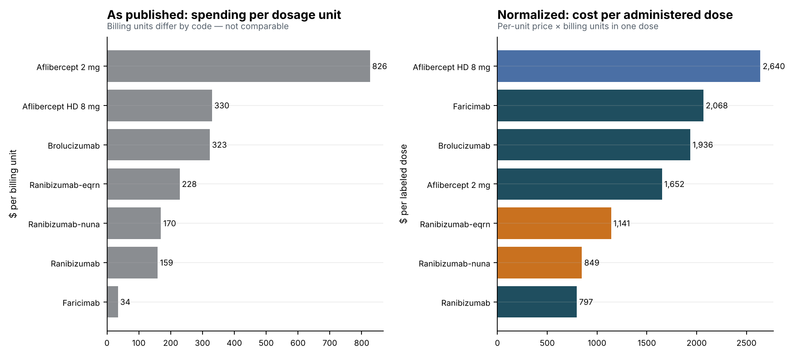
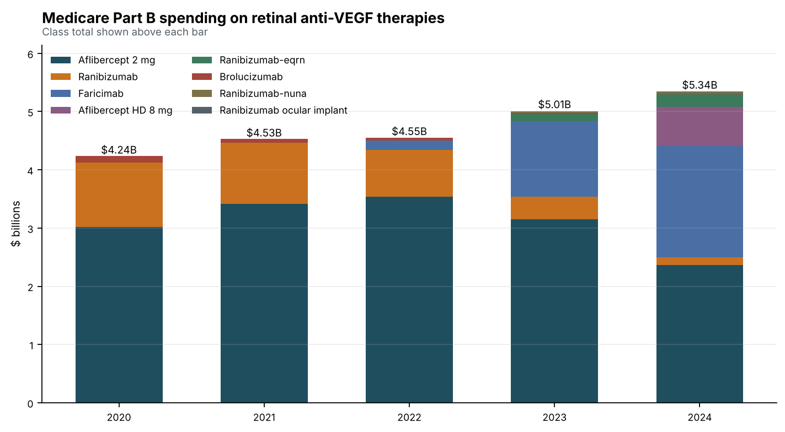
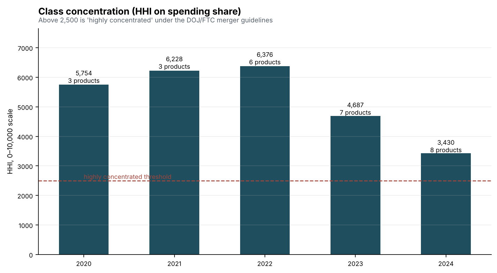
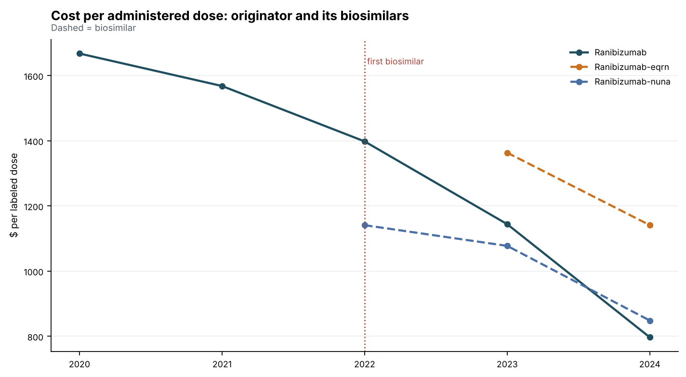
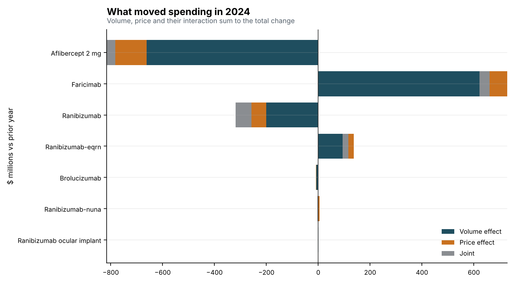
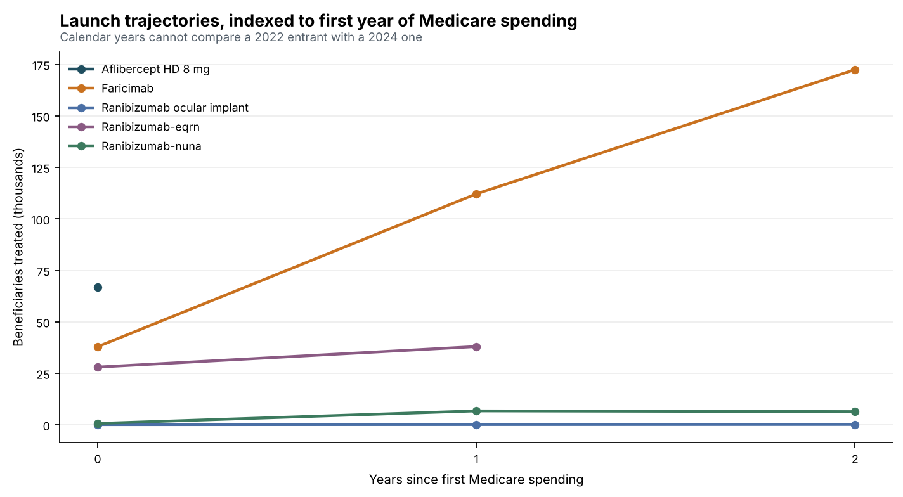

# Medicare Drug Pricing Analysis

What happens to a drug class when competitors arrive — measured on real
Medicare claims data rather than modeled.

This project builds a **PostgreSQL** warehouse from the CMS *Medicare Part B
and Part D Spending by Drug* files and uses **Python** to analyze the retinal
anti-VEGF class between 2020 and 2024: a five-year window containing three new
entrants, two biosimilars, one failed launch and one line extension. It is a
natural experiment in competitive entry, and the data is public.

The headline finding is methodological, and it changes the answer:

> **CMS's "average spending per dosage unit" is not a price you can compare
> across drugs.** A dosage unit is the HCPCS billing unit, which is defined per
> code — one product in this class bills per 1 mg, another per 0.1 mg. On the
> published column the products span **24×**. On cost per administered dose
> they span **3.3×**, and the cheapest-looking drug in the class turns out to
> be the second most expensive.

---

## What it found

**Normalizing the price axis reorders the market.** Faricimab is billed per
0.1 mg and dosed at 6 mg, so its published figure of $34 per unit is 60 units
away from a $2,068 dose. Aflibercept, billed per 1 mg and dosed at 2 mg, looks
24× more expensive per unit and is actually 20% cheaper per injection.



**The class got more competitive without becoming competitive.** Spending rose
from **$4.24B to $5.34B** (+26%) while products billing Medicare went from
**3 to 8**. Concentration fell from an HHI of **5,754 to 3,430** and the
leader's share from **71% to 44%** — but both readings remain far above the
2,500 the DOJ/FTC merger guidelines call highly concentrated.




**Price defence did not retain volume.** After biosimilars entered, the
reference product's cost per dose fell **49%** and it still lost **71%** of
its treated beneficiaries and **88%** of its spending. The part worth pausing
on: by 2024 **both** of its biosimilars cost *more* per administered dose than
the originator they were meant to undercut. The incumbent cut price faster
than its challengers and lost the market anyway.



**Volume and price move spending for different reasons.** Decomposing 2024:
faricimab added **$621M**, of which **$729M** was volume and **($69M)** price.
Aflibercept lost **($783M)** — **($662M)** volume, **($153M)** price. One is a
share problem and one is a margin problem; a spending total shows neither.




Full write-up with every figure: **[docs/findings.md](docs/findings.md)**.

---

## Quick start

```bash
git clone https://github.com/<your-username>/medicare-drug-pricing-analysis.git
cd medicare-drug-pricing-analysis
pip install -r requirements.txt

make test      # 54 tests, no database required
make analysis  # regenerates docs/findings.md, docs/data_quality.md and all charts
```

The CMS files are committed under `data/raw/` (5.6 MB, public domain), so this
runs immediately after a clone.

With PostgreSQL:

```bash
make db-up        # docker compose: postgres:16
make load         # applies the DDL and views, loads ~77k drug-year rows
make analysis-db  # same analysis, reading the warehouse views
```

```sql
-- Cost per administered dose, which the published column cannot give you
SELECT display_name, entrant_type,
       avg_spend_per_dosage_unit AS published_per_unit,
       units_per_dose,
       cost_per_dose_usd
FROM cms.v_class_drug_year
WHERE data_year = 2024 AND marketed AND include_in_price_comparison
ORDER BY cost_per_dose_usd DESC;
```

---

## The data traps, and what the code does about them

The CMS files are clean in the ordinary sense — no malformed rows, no junk
headers. They are still easy to get wrong, and each of these is quantified in
**[docs/data_quality.md](docs/data_quality.md)** and enforced by a test.

**Part D ships every drug twice.** There is an `Overall` row per drug *and* a
row per manufacturer. Summing the file as delivered reports **$577.3B** of
2024 Part D spending against an actual **$288.7B** — a clean 100% overstatement,
and not a uniform one, since the manufacturer count per drug ranges from 1 to
46. The base view `v_spending` applies the filter once so no downstream query
can forget it, and a test asserts the manufacturer rows reconcile to `Overall`
— which is what proves the filter deduplicates rather than discards.

**A blank year is not a zero.** It means the drug had no Medicare spending
that year, almost always because it had not launched. Zero-filling turns a 2022
launch into a 2020 collapse; dropping the rows loses the launch date. Both are
preserved behind a `marketed` flag, and the schema has a CHECK constraint that
refuses a row claiming to be unmarketed while carrying measures.

**Part D's published price is a weighted average, Part B's is not.** For Part B,
spending ÷ units reproduces the published per-unit figure exactly. For Part D
it diverges on 44% of rows, because CMS weights across manufacturers. This
matters because a price/volume decomposition rests on `spending = units × price`
— an identity that simply does not hold for Part D. The bridge uses the implied
price, `v_price_measure_divergence` measures the gap, and a test pins the
behaviour of both programs so a future CMS change surfaces here.

**A five-year CAGR is wrong for a drug that launched in year four.** Growth is
computed over each product's own marketed span, with the span length reported
beside the rate.

**One HCPCS code can be two different drugs commercially.** Bevacizumab is
billed under a single code for systemic oncology and, as a compounded
repackage, for intravitreal use. It is 14% of a naive class total in 2020 and
3% by 2024, so leaving it in makes oncology volume look like retinal share
loss. It is excluded from class totals — and the exclusion, like every other,
carries a written reason in `src/cms/classes.py` that a test requires to be
non-empty.

**CMS flags its own outliers.** 7.6% of Part B and 13.4% of Part D drug-years
are flagged as having per-unit spending distorted by outlier records. Those
rows are kept but excluded from price conclusions rather than silently averaged
in.

---

## How it is built

```
sql/    01_schema.sql           star-ish schema, long grain, CHECK constraints
        02_views_pricing.sql    YoY, CAGR over own span, price/volume bridge,
                                published-vs-implied price divergence
        03_views_market.sql     dose-normalized class view, share, HHI,
                                launch trajectories, biosimilar erosion
src/cms/
        extract.py    reads the raw files; discovers data years from the header
                      and raises on an unexpected shape rather than silently
                      producing a shorter trend
        transform.py  wide → long; blank/zero semantics, name markers,
                      the Part D Overall split
        classes.py    therapeutic class definition, billing-unit parsing,
                      labeled doses, and the dose normalization
        quality.py    measures every trap above and writes data_quality.md
        pipeline.py   raw files → warehouse-ready frames
        load.py       CLI: apply DDL, load, verify
        analysis.py   the analysis, charts, and findings.md
tests/  54 tests across extraction, transforms, class definitions and the SQL
```

**The SQL is tested.** `tests/test_sql_views.py` loads the real CMS data into
DuckDB, applies the *actual* view files from `sql/`, and asserts properties
that must hold for any release: the bridge components sum to the change in
spending, class shares sum to one, cumulative enrollment never decreases, the
incumbent lost both price and patients after biosimilar entry. CI runs those
in-process, builds the warehouse against a real PostgreSQL 16 service to prove
the DDL is valid Postgres, and **regenerates `findings.md` and fails if it
differs from what is committed** — so the written conclusions can never drift
from the code that produced them.

One test deserves singling out. `test_raw_unit_price_and_dose_price_rank_differently`
asserts that ranking by the published column and by cost per dose give
different orders. If a future CMS release ever makes them agree, the central
claim of this project needs revisiting — and the test suite will say so.

---

## What is deliberately not modeled

**Cost per patient-year.** It would be the more useful number and it would be
an invented one. These products have different labeled dosing intervals, and
real-world treat-and-extend practice differs from the label by an amount this
dataset cannot observe. Cost per administered dose is measured; multiplying it
by an assumed injection frequency would convert a measured price into an
assumption wearing a measurement's clothes.

**Net price.** CMS spending is gross of manufacturer rebates and
Part B/D differ in how discounts flow. Nothing here is a net-price estimate.

**Causation.** The class saw entry and prices moved. This project measures
both and does not claim the first caused the second.

---

Source: CMS *Medicare Part B and Part D Spending by Drug*, annual releases —
U.S. government works, public domain. Labeled doses are from the products' FDA
prescribing information and are listed in one table in `src/cms/classes.py`.
Built with Python 3.10+, PostgreSQL 16, pandas, SQLAlchemy, matplotlib, and
DuckDB for the test harness. MIT licensed.
