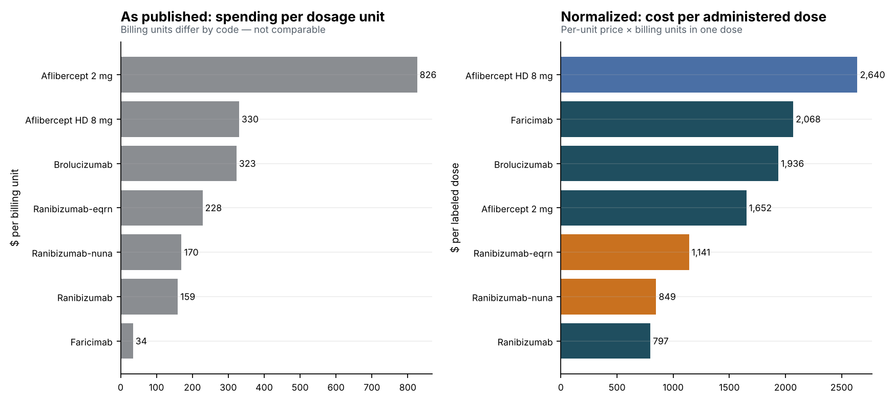
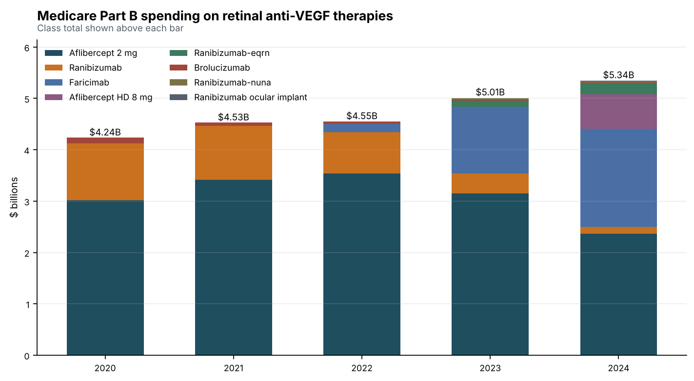
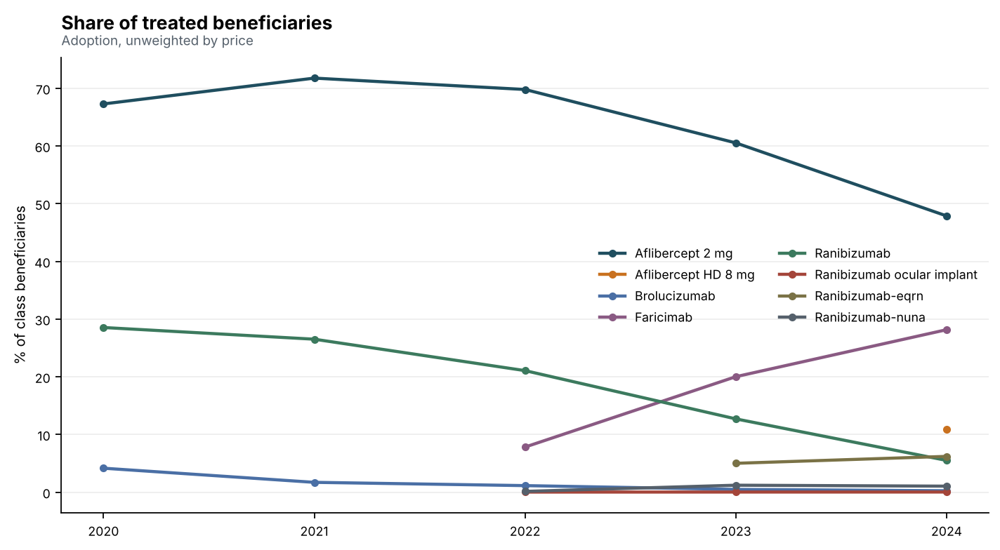
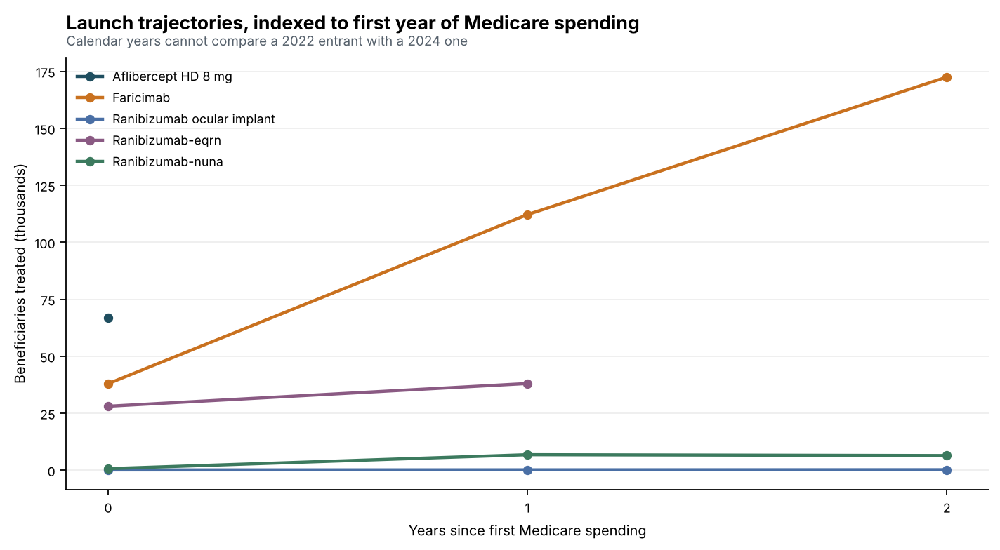
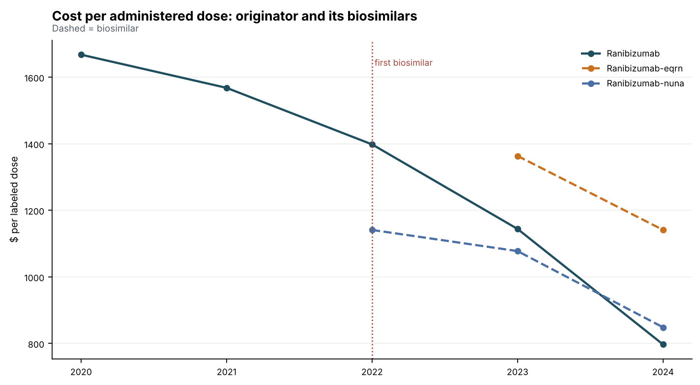
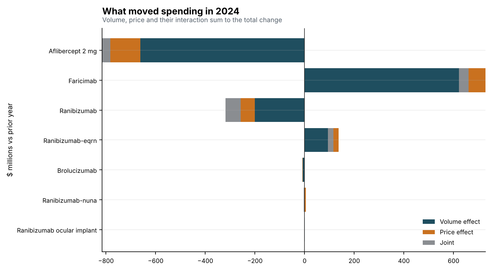
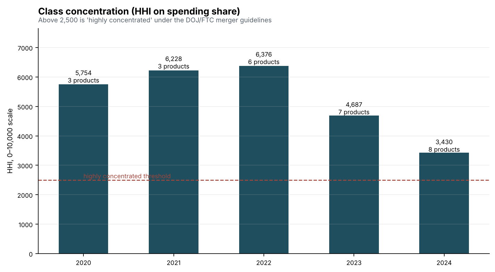

# Retinal anti-VEGF therapies in Medicare Part B, 2020–2024

Generated by `python -m cms.analysis`. Every figure is computed from the
CMS annual files; none is typed in.

## Headline

Class spending moved from **$4.24B** in 2020 to **$5.34B** in 2024 (**+26.0%**), while the number of products billing Medicare rose from **3** to **8**.

## 1. The published price column is not a price

CMS reports average spending per *dosage unit*, and for Part B a dosage unit
is the HCPCS billing unit — which is defined per code. Within this class one
code bills per 1 mg and another per 0.1 mg, so the published figures are in
different units and cannot be compared to each other.

On the raw column, **Aflibercept 2 mg** looks like the most
expensive product in 2024 at **$826** per unit and **Faricimab** the cheapest at **$34**.

Multiplying by the billing units in one labeled dose puts them on a common
axis — cost per administered dose — and reorders them:

| Product | Type | Published $/unit | Units per dose | $ per dose |
|---|---|---|---|---|
| Aflibercept HD 8 mg | line-extension | $330.00 | 8.0 | **$2,640** |
| Faricimab | originator | $34.47 | 60.0 | **$2,068** |
| Brolucizumab | originator | $322.70 | 6.0 | **$1,936** |
| Aflibercept 2 mg | originator | $825.90 | 2.0 | **$1,652** |
| Ranibizumab-eqrn | biosimilar | $228.24 | 5.0 | **$1,141** |
| Ranibizumab-nuna | biosimilar | $169.71 | 5.0 | **$849** |
| Ranibizumab | originator | $159.40 | 5.0 | **$797** |

The spread between the most and least expensive product narrows from **24.0×** on the raw column to **3.3×** per dose. Any procurement or market-access conclusion drawn from the raw
column is drawn from the wrong number.

## 2. Competitive entry reset the class

Products that began billing Medicare after 2020:

- **Faricimab** — first Medicare spending in 2022
- **Ranibizumab ocular implant** — first Medicare spending in 2022
- **Ranibizumab-nuna** — first Medicare spending in 2022
- **Ranibizumab-eqrn** — first Medicare spending in 2023
- **Aflibercept HD 8 mg** — first Medicare spending in 2024

Concentration fell from an HHI of **5,754** in 2020 to **3,430** in 2024. The leader's share of class spending went from **71%** (Aflibercept 2 mg) to **44%** (Aflibercept 2 mg).

Both readings still sit above the 2,500 threshold the DOJ/FTC merger
guidelines treat as highly concentrated — this is a class that became more
competitive without becoming competitive.

## 3. What moved spending in 2024

Decomposing each product's change in spending into volume, price and their
interaction (on the implied price, spending ÷ units, which is the only
measure that satisfies the identity the decomposition rests on):

- Largest increase: **Faricimab**, **$621M**, of which **$729M** is volume and **($69M)** is price.
- Largest decrease: **Aflibercept 2 mg**, **($783M)**, of which **($662M)** is volume and **($153M)** is price.

The distinction matters: a decline driven by volume is a share problem, and
one driven by price is a margin problem. They call for different responses
and they are not visible in a spending total.

## 4. What biosimilar entry did to the incumbent

Biosimilars referencing **Ranibizumab** first billed Medicare in **2022**. Measured against 2021, the last full year before entry, by 2024 the originator's:

- cost per administered dose fell **-49.2%** ($1,568 → $797)
- treated beneficiaries fell **-70.5%** (114,432 → 33,741)
- total spending fell **-87.7%**

The counterintuitive part is where the biosimilars ended up. Of the **2** biosimilars on the market in 2024, **2** cost *more* per administered dose than the originator they were meant to undercut — the incumbent cut price faster than its challengers did, and still lost **57%** of the molecule's treated beneficiaries to them.

For anyone modeling a launch into a class like this, that is the number
worth carrying: price defence did not retain volume.

## Charts

---

Source: CMS Medicare Part B and Part D Spending by Drug, annual releases.
U.S. government works, public domain. Labeled doses are from the products'
FDA prescribing information and are listed in `src/cms/classes.py`.

Dosing interval is deliberately not modeled, so cost per dose is measured
and cost per patient-year is not: label intervals differ across these
products and real-world treat-and-extend practice differs from the label.
Asserting an interval would convert a measured price into an assumed one.